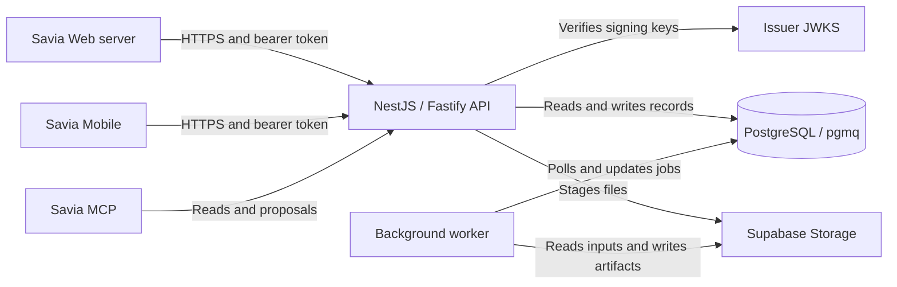

<!-- markdownlint-disable-next-line MD041 -->
<div align="center">

<h1>Savia Backend</h1>

<p><strong>The workspace API and background worker for Savia personal finance clients.</strong></p>

<p>
<a href="https://github.com/diegnghtmr/savia-backend/actions/workflows/ci.yml"></a>


<a href="LICENSE"></a>
</p>

<p>
<a href="https://diegnghtmr.me/en/work/savia/"><strong>Case study</strong></a> &bull;
<a href="#quick-start"><strong>Quick start</strong></a> &bull;
<a href="#architecture"><strong>Architecture</strong></a> &bull;
<a href="https://github.com/diegnghtmr/savia-web"><strong>Web app</strong></a> &bull;
<a href="https://github.com/diegnghtmr/savia-mobile"><strong>Mobile app</strong></a> &bull;
<a href="https://github.com/diegnghtmr/savia-mcp"><strong>MCP server</strong></a>
</p>

</div>

Savia is a personal finance system in development that keeps accounts, spending, and budgets together without treating transfers as income or expenses. This repository implements the authenticated API and the worker that processes jobs outside a request. It is also the source of the checked-in OpenAPI contract used to generate clients.

## Features

- **Personal workspace setup.** Create the profile, workspace, and owner membership in one database transaction; an identical retry returns the existing identifiers.
- **Workspace-scoped ledger.** Manage accounts, transactions, transfers, and currency exchanges against the caller's workspace.
- **Budget planning.** Track allocations, sinking funds, debts, and recurring rules alongside the ledger.
- **File and report jobs.** Process work such as receipt OCR, reports, and exports in a separate worker.
- **Client contract.** Expose health and versioned finance operations in the committed OpenAPI document.

## Quick start

Install Node.js **24.18.0** and pnpm **11.13.0**. Use a PostgreSQL database with the [Supabase migrations](supabase/migrations/) applied and an issuer that publishes its signing keys over HTTPS. The repository's local Supabase configuration uses PostgreSQL 17.

```sh
git clone https://github.com/diegnghtmr/savia-backend.git
cd savia-backend
pnpm install --frozen-lockfile
pnpm build
```

Set these values in the API or worker process environment as applicable:

| Variable                                    | Purpose                                                                                     | Default |
| ------------------------------------------- | ------------------------------------------------------------------------------------------- | ------- |
| `DATABASE_URL`                              | PostgreSQL connection URL for persisted operations.                                         | None    |
| `JWT_ISSUER`                                | Expected token issuer.                                                                      | None    |
| `JWT_AUDIENCE`                              | Expected audience for application access tokens.                                            | None    |
| `JWT_ALGORITHMS`                            | Comma-separated list of accepted asymmetric signing algorithms; use the issuer's algorithm. | None    |
| `JWT_JWKS_URI`                              | HTTPS URL of the issuer's public signing keys.                                              | None    |
| `PORT`                                      | API listener port.                                                                          | `3000`  |
| `SUPABASE_URL`, `SUPABASE_SERVICE_ROLE_KEY` | Storage project URL and private service credential for file operations.                     | None    |
| `SAVIA_CREDENTIAL_KEY`                      | Base64-encoded 32-byte key for encrypted AI credentials.                                    | None    |

```sh
pnpm start
```

Open `http://localhost:3000/health`. Unknown routes return `404`. Start `pnpm start:worker` in another shell when running background jobs. For authenticated routes, send a bearer token from the configured issuer. See [the API contract](openapi/savia.openapi.yaml) for `POST /v1/onboarding`, accounts, transactions, and the other `/v1` operations.

## Architecture

The API verifies the caller's JWT and uses PostgreSQL for workspace and financial records. The worker polls PostgreSQL-backed queues and uses Supabase Storage for artifacts. Onboarding returns `201` for creation, `200` for an identical replay, and `409` for a conflicting setup.



## OpenAPI contract

The committed contract includes `GET /health` and operations under `/v1`,
including onboarding, accounts, and transactions.

`openapi/savia.openapi.yaml` is the client-generation input. Its provenance records
the local planning source constants. Backend CI cannot access, authenticate, or independently
re-hash that local source; it validates only committed constants and executable contract identity.

## Tech stack

| Layer                | Technology                                 |
| -------------------- | ------------------------------------------ |
| Runtime              | Node.js 24.18.0, TypeScript 5.9.3          |
| HTTP                 | NestJS 11.1.28, Fastify 5.10.0, jose       |
| Persistence          | PostgreSQL 17 locally, `pg` 8.22.0, pgmq   |
| Contract and quality | OpenAPI, Redocly CLI 2.39.0, Vitest 4.1.10 |

## Testing

```sh
pnpm test
pnpm openapi:verify
pnpm check
```

`pnpm check` includes formatting, lint, architecture checks, type checks, tests, build, and OpenAPI verification and lint. CI also runs PostgreSQL/Supabase row-level security and schema checks and the integration suites, split across ten parallel shards; the required `check` status passes only when `pnpm check` and every shard pass. Each shard runs its database suites serially on one disposable Supabase stack, resetting the database and wiping Storage before each suite. The SQL contracts and transaction mutation proof retain separate setups. `pnpm check` verifies that each suite is assigned to exactly one shard. CI installs Tesseract with English and Spanish language data on the host, and the PDF renderer shard provisions Chromium. See [package.json](package.json) for the `test:database*` and `test:integration:*` entry points, and [Integration tests](#integration-tests) for the one-stack and containerized OCR runners.

## Integration tests

Run these commands from the checkout on a Linux host with Docker, `flock`, and
this project's Node and pnpm dependencies installed:

```sh
pnpm test:integration:all --list
pnpm test:integration:all
pnpm test:integration:all postgres-pool workspace
pnpm test:integration:ocr
```

`test:integration:all` runs every `test:integration:<name>` suite. It starts one
local Supabase stack, reapplies all migrations without seed data, and clears
Storage files before each database suite. Suites run serially, and the runner
prints a summary and tears the stack down on exit, including after failure or
interruption. The runner refuses to clear Storage unless the mounted volume
belongs to this disposable project. The standalone PDF renderer suite still
requires Playwright Chromium on the host
(`pnpm exec playwright-core install chromium`). The schema contract and SQL
migration/rollback gates are separate because they build and check deliberately
different database states; CI still runs them separately.

The full run and `test:integration:ocr` run `forecasts`, `receipt-ocr`, and
`receipt-ocr-engine` in a Docker image with pinned Node, pnpm and Tesseract
English and Spanish data. No host Tesseract installation is required. The first
build downloads public packages; subsequent builds reuse cached layers. The OCR
DB suites use Linux Docker host networking to reach the disposable Supabase
stack. Run one OCR suite with `pnpm test:integration:ocr receipt-ocr-engine`.
Run `pnpm test:docker-context` to verify credential-like paths are excluded
from the Docker build context using only empty synthetic files.

The full and OCR runners hold `/tmp/savia-db.lock` through teardown. Existing
`pnpm run test:integration:<name>` commands are unchanged. If running a legacy
DB command alongside the full or OCR runner, acquire the same lock explicitly,
for example `flock /tmp/savia-db.lock pnpm run test:integration:workspace`.
Do not wrap the full or OCR command in a second `flock`.

Run `pnpm test:runner-isolation` to check that a Storage object written in one
suite is absent before the next suite starts. The probe requires `curl` and uses
the shared runner's lock.

All disposable DB runners wait up to 30 seconds for the host ports declared in
`supabase/config.toml` to become free before starting Supabase. If Docker reports
a port allocation error, the runner stops the partial stack, checks the ports
again, and retries once if they become free. CI also staggers stack startups and
retries public registry rate limits. Failed starts retain sanitized diagnostics
when safe.

On one Linux Docker host, five DB suites (pool, transaction resilience,
workspace, transaction creation and receipt foundation; 85 tests) took 7m25s
with separate stacks and 4m09s with the shared stack. Based on the four warm
resets, the 88 DB suites project to about 55 minutes, plus the OCR image build
and standalone suite runtime. This is a projection, not a full-run measurement.
To reproduce a subset of a CI shard with host OCR dependencies, run
`bash scripts/run-integration-suites.sh ci postgres-pool workspace`. The
workflow lists the complete suite selection for each shard.

## Project structure

```text
src/
  main.ts, worker.ts           API and worker entry points
  identity/                    Profiles, workspaces, and membership
  accounts/, ledger/, budgets/ Financial operations
  platform/                    Database, storage, and JWT adapters
supabase/                      Local config, migrations, and database tests
openapi/                       Contract, operation manifest, and provenance
test/                          Unit, HTTP, and integration tests
```

## Related repositories

- [savia-web](https://github.com/diegnghtmr/savia-web) — browser client and workspace setup.
- [savia-mobile](https://github.com/diegnghtmr/savia-mobile) — Expo app for Android and iOS.
- [savia-mcp](https://github.com/diegnghtmr/savia-mcp) — local and remote MCP interface.
- [savia-cli](https://github.com/diegnghtmr/savia-cli) — command-line client.

## License

[MIT](LICENSE).
